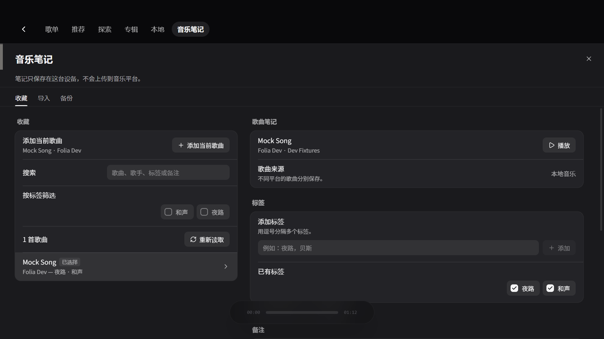

# Folia 音乐笔记

给歌曲写备注、打标签，或把喜欢的片段记为时间点书签。笔记按歌曲来源和 ID 保存，可以从已登录的音乐账号导入歌单，也可以导出 JSON 备份。



## 安装与使用

1. 在 [Releases](https://github.com/setobox/folia-music-notes/releases/latest) 的 **Assets** 中下载 `music-notes-<版本>.zip`。
2. 打开 Folia 的「设置 → 模组」，将 ZIP 拖入并启用。安装目录固定为 `mods/music-notes/`，更新时把新版 ZIP 拖到同一位置，再次启用即可。支持 Folia `>=0.7.29 <0.8.0`。
3. 在首页打开「音乐笔记」，或通过命令面板选择「记下当前歌曲」。填写标签、备注和时间点后点「保存」。

「导入」从已登录账号读取歌单，保留已有笔记。「备份」可导出整个笔记库或从 JSON 补入缺少的记录。笔记保存在当前 Folia 应用资料的 `FoliaMusicNotes` 数据库中。卸载模组后笔记仍会保留，重装后可继续使用。换设备或清除应用资料前，请先导出备份。

## 开发与打包

在仓库根目录使用 Node.js 24 和 `package.json` 指定版本的 pnpm。运行以下命令可复现发布构建和检查：

```sh
pnpm install --frozen-lockfile
pnpm run typecheck
pnpm run build
pnpm test
```

`src/core/` 实现笔记存储、标签和备份，`src/ui/` 实现笔记界面。`src/foliumCompatibility.ts` 集中了读取私人歌单和当前歌曲标识所需的宿主内部接口，升级 Folia 后需要核对这两项功能。`mod.json` 中的 `playback.control` 用于播放歌曲和跳转到书签，`ponder.targets` 用于注册使用教程。

构建脚本在 `dist/music-notes/` 生成模组文件，在 `release/` 生成可直接安装的 ZIP。压缩包包含客户端入口、清单、预览图和许可证。

## 发布

更新 `mod.json` 的版本号，提交并推送源码，再推送匹配的 `v<版本>` 标签。例如首版使用 `v1.0.0`。GitHub Actions 会检查版本、构建、运行测试，并把 ZIP 作为同名 GitHub Release 的附件发布。

GitHub Release 提供作者构建的安装包。Folium 市场的签名是独立流程，市场目前从指定 Git 提交的目录中读取已构建的文件。[市场收录规则](https://github.com/chthollyphile/folium-compound#收录第三方模组)

## 许可证

音乐笔记沿用 AGPL-3.0。设置控件、样式和 Folium 类型声明取自 [Folia](https://github.com/chthollyphile/folia-major)。第三方依赖的许可证随安装包收录在 `THIRD_PARTY_NOTICES.txt`。完整授权文本见 [LICENSE](LICENSE)。
